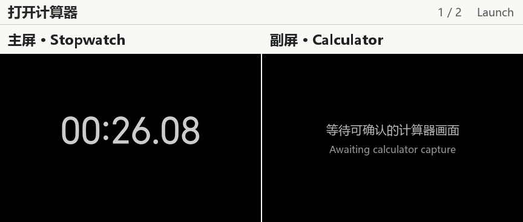

# phone-use

[简体中文](README.md) · [Quick start](#quick-start) · [Try the calculator](#try-it-with-a-calculator) · [Download v0.1.2](https://github.com/ShuangjieGao/phone-use/releases/tag/v0.1.2)

Give an AI assistant its own Android display. In this real tablet capture, Android Clock keeps time on the main display while Xiaofeiyu’s AgY model opens Xiaomi Calculator on a virtual display using `phone_launch`. Both feeds use the same device clock.

<picture>
  <source media="(prefers-reduced-motion: reduce)" srcset="docs/images/phone-use-demo-still.png">
  
</picture>

*The 13-second GIF shows two excerpts from one take at their original speed, with about 57 seconds omitted between them. Watch the stopwatch while the other display opens Calculator, then watch its angle-mode key change.* [Watch the continuous 70-second recording (MP4)](docs/images/phone-use-continuous.mp4) · [View a synchronized still](docs/images/phone-use-demo-still.png)

ADB supplied the main-display Start tap. The model requested the calculator launch; a test script used the same MCP tools for the later angle-mode taps and readbacks. Each feed shows a crop of the native app, with a waiting label until the first verified calculator frame.

We tested phone-use on **rooted Android 13 with an ARM64 Debian chroot**. The assistant connects over Model Context Protocol (MCP) using standard input and output. It can read text with OCR, request a screenshot when it needs to see an icon, and tap a target from the latest observation.

## Quick start

You need a rooted Android device with a Debian chroot that can access Android's PID 1, mount namespace and abstract Unix sockets. The chroot needs Python 3.9+, permission to run `nsenter`, and FFmpeg with `-fps_mode` support. Use **scrcpy-server 4.1** for this release.

**1. Put scrcpy-server on the Android device.** On a Windows PC with ADB connected, run the following in PowerShell. If multiple devices are connected, add `-s <serial>` to the ADB command. The checksum is for the official 4.1 server. [Upstream release](https://github.com/Genymobile/scrcpy/releases/tag/v4.1)

```powershell
curl.exe -fL -o scrcpy-server-v4.1 https://github.com/Genymobile/scrcpy/releases/download/v4.1/scrcpy-server-v4.1
$expected = 'deacb991ed2509715160ffdc7907e47b4160eb30d1566217e9047fd5b8850cae'
if ((Get-FileHash .\scrcpy-server-v4.1 -Algorithm SHA256).Hash -ne $expected) { throw 'scrcpy-server checksum mismatch' }
adb push scrcpy-server-v4.1 /data/local/tmp/scrcpy-server-v4.1.jar
```

**2. Install phone-use inside Debian.** Run these commands as root. The `vision` extra adds Pillow so the server can compare the area around a tap target when another part of the screen animates.

```sh
apt-get update
apt-get install -y python3-venv util-linux ffmpeg tesseract-ocr tesseract-ocr-chi-sim tesseract-ocr-eng
python3 -m venv /opt/xfy-phone-venv
/opt/xfy-phone-venv/bin/python -m pip install 'phone-use[vision] @ https://github.com/ShuangjieGao/phone-use/releases/download/v0.1.2/phone_use-0.1.2-py3-none-any.whl'
```

Upgrading from v0.1.0? Download the new wheel first. In your existing venv, run `python -m pip uninstall xfy-phone-use`, then `python -m pip install './phone_use-0.1.2-py3-none-any.whl[vision]'`. Both releases share a Python import path. The old CLI names remain available as aliases in v0.1.2.

**3. Start the display.** Leave a different app in the foreground on the main display. This example opens Settings on the virtual display. Replace the package name with the Android app you want to use.

```sh
/opt/xfy-phone-venv/bin/phone-display run \
  --server-jar /data/local/tmp/scrcpy-server-v4.1.jar \
  --package com.android.settings --width 900 --height 1600 --density 360
```

The command prints a display ID and dimensions when ready. Leave it running.

**4. Connect your MCP client.** Configure the client to launch the following stdio server **inside the same chroot and under the same UID** as the display runtime. Both processes use the private socket in `XFY_PHONE_RUNTIME`.

```json
{
  "mcpServers": {
    "phone-use": {
      "command": "/opt/xfy-phone-venv/bin/phone-use",
      "env": { "XFY_PHONE_RUNTIME": "/run/xfy-phone-use" }
    }
  }
}
```

## Check the connection

With the display running, execute this from the repository root in the chroot. It checks the MCP server and display without tapping anything.

```sh
python3 examples/check.py --server /opt/xfy-phone-venv/bin/phone-use
```

If you installed the wheel on its own, ask your MCP client to call `phone_status` and report the display ID and dimensions. Look for `ready: true` before trying an input.

The v0.1.2 check on the same tablet after the calculator close-up returned:

```text
Server   phone-use 0.1.2
Tools    7 available
Display  ready, 900 x 1600 px
Frame    received (OCR off, screenshot off)
```

If the check reports `primary foreground unverified`, bring an app to the foreground on the main display and run it again. Version 0.1.2 recognizes Android’s short and fully qualified names for the same Activity. Different foreground components still stop the check.

## Try it with a calculator

For a first run, use a calculator with a **DEG/RAD** toggle. On the tested Xiaomi tablet its package was `com.miui.calculator`. Try the following prompt, substituting the package name on your device.

> Check the secondary display. Open `com.miui.calculator`, read the current angle unit, switch it once, and tell me which unit is now visible. Then restore the original setting and read it back.

On the test tablet the sequence was **DEG → RAD → DEG**. Each tap used an `observation_id` from a fresh view. If the control is an unlabeled icon, the assistant can request a screenshot with `screenshot: true, elements: false` and tap by pixel coordinates.

[Watch the native calculator keypad (about nine seconds).](docs/images/calculator-live.gif) In this separate take, MCP read back `rad` at 3.6 seconds and the restored `deg` at 7.3 seconds. The angle-mode button is at the top left.

**Does the physical display still accept input?** In a second dual-display take, the AgY model opened Calculator on the virtual display. An ADB tap on the main display marked a lap in Android Clock. After the recording, the paused stopwatch showed **12.73 s** for lap one and **14.18 s** total. The next angle-button input in this take was declined while the virtual display was changing. [Synchronized clip](docs/images/dual-lap.gif) · [Native lap result captured after the clip](docs/images/lap-receipt.png)

## Tools

| Tool | What it does |
| --- | --- |
| `phone_status` | Returns readiness, screen dimensions and the foreground activity when available. |
| `phone_launch` | Opens an installed Android app by package name on the secondary display. |
| `phone_observe` | Returns an observation ID and OCR text regions. Screenshots are opt-in. |
| `phone_tap` | Taps a text region by ID or a point in the observed screen's pixel coordinates. |
| `phone_swipe` | Swipes between two points on the observed screen. |
| `phone_type` | Types printable ASCII into a focused input. OCR can read English and Simplified Chinese. |
| `phone_key` | Sends `back`, `enter` or `del`. |

## Watch the assistant and troubleshoot

Read `id` from `/run/xfy-phone-use/display.json` in Debian. If the ID is `7`, run the following on your Windows PC with scrcpy 4.1 and an ADB connection.

```powershell
scrcpy --display-id=7 --no-control --no-audio --no-power-on
```

You can close the viewer while the assistant keeps using its display. To release the display itself, run `/opt/xfy-phone-venv/bin/phone-display stop` in a second Debian terminal.

| What you see | What to try |
| --- | --- |
| `Primary foreground could not be verified` | Bring a recognizable app to the foreground on the main display, then check `phone_status` again. |
| An input reports that the view has changed | Call `phone_observe` again and select the target from the new view. |
| An app launches on the wrong display or changes input focus | Start with Settings to check your setup. Secondary-display support varies by app and Android build, and system input focus can shift briefly. |

To run the source tests, use `python -m unittest discover -s tests -v` from the repository root.

Trying a different device? [Share a compatibility report](https://github.com/ShuangjieGao/phone-use/issues) with the device model, Android version and app you tested. If phone-use helped you, you can star the repo or share the [native dual-display capture](docs/images/phone-use-card.png).
