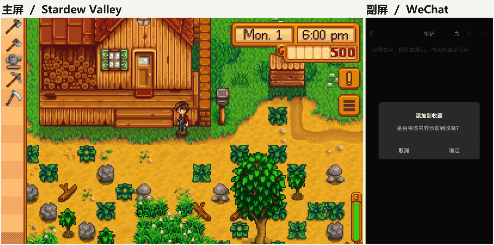

# phone-use

[简体中文](README.md) · [Install from source](#quick-start) · [Connect your assistant](#connect-your-mcp-client)

**Play Stardew Valley on the main display of an Android tablet while an assistant uses a different app.** phone-use exposes seven stdio MCP tools for observing and controlling an Android virtual display. Tested on rooted Android 13 with an ARM64 Debian chroot.

<picture>
  <source media="(prefers-reduced-motion: reduce)" srcset="docs/images/stardew-wechat-poster.png">
  
</picture>

| While the game stays on the main display | On the virtual display | Full recording |
| --- | --- | --- |
| The player walks outside the farmhouse. | The assistant confirms saving a sample seed shopping list in WeChat Favorites. The list uses Android sharing; no personal conversations appear. | [WeChat · 24 s](docs/images/stardew-wechat.mp4) · [Full-size still](docs/images/stardew-wechat-poster.png) |
| The player moves across the farm. | The assistant opens Calculator. A demo script enters `24 × 20` through MCP and reads back **480 gold**. | [Calculator · 23 s](docs/images/stardew-fullscreen.mp4) · [Full-size still](docs/images/stardew-fullscreen-poster.png) |

Both examples show the full, synchronized displays of the same tablet running the Android edition of the game. Each recording plays continuously at its original speed.

## Quick start

You need a rooted Android device with a Debian chroot that can access Android's PID 1, mount namespace and abstract Unix sockets. The chroot needs Python 3.9+, permission to run `nsenter`, and FFmpeg with `-fps_mode` support. Use **scrcpy-server 4.1** with phone-use.

**1. Put scrcpy-server on the Android device.** On a Windows PC with ADB connected, run the following in PowerShell. If multiple devices are connected, add `-s <serial>` to the ADB command. The checksum is for the official 4.1 server. [Upstream release](https://github.com/Genymobile/scrcpy/releases/tag/v4.1)

```powershell
curl.exe -fL -o scrcpy-server-v4.1 https://github.com/Genymobile/scrcpy/releases/download/v4.1/scrcpy-server-v4.1
$expected = 'deacb991ed2509715160ffdc7907e47b4160eb30d1566217e9047fd5b8850cae'
if ((Get-FileHash .\scrcpy-server-v4.1 -Algorithm SHA256).Hash -ne $expected) { throw 'scrcpy-server checksum mismatch' }
adb push scrcpy-server-v4.1 /data/local/tmp/scrcpy-server-v4.1.jar
```

**2. Install from source in the tablet's Debian chroot.** Run as root. If you already have a checkout, use that directory.

```sh
apt-get update
apt-get install -y git python3-venv util-linux ffmpeg tesseract-ocr tesseract-ocr-chi-sim tesseract-ocr-eng
git clone https://github.com/ShuangjieGao/phone-use.git
cd phone-use
python3 -m venv /opt/xfy-phone-venv
/opt/xfy-phone-venv/bin/python -m pip install '.[vision]'
```

If this venv still contains the old package named `xfy-phone-use`, uninstall that package before installing from the checkout. Both package names share a Python import path.

**3. Start the display.** Leave a different app in the foreground on the main display. This example opens Settings on the virtual display. Replace the package name with the Android app you want to use.

```sh
/opt/xfy-phone-venv/bin/phone-display run \
  --server-jar /data/local/tmp/scrcpy-server-v4.1.jar \
  --package com.android.settings --width 900 --height 1600 --density 360
```

The command prints a display ID and dimensions when ready. Leave it running.

## Connect your MCP client

Configure the client to launch this stdio server inside the same chroot, under the same UID as the display runtime. Both processes must use the same private socket directory.

```json
{
  "mcpServers": {
    "phone-use": {
      "command": "/opt/xfy-phone-venv/bin/phone-use",
      "env": { "XFY_PHONE_RUNTIME": "/run/xfy-phone-use" }
    }
  }
}
```

## Check the connection

With the display running, execute this from the repository root in the chroot. It checks the MCP server and display without tapping anything.

```sh
python3 examples/check.py --server /opt/xfy-phone-venv/bin/phone-use
```

You can also ask your MCP client to call `phone_status` and report the display ID and dimensions. Look for `ready: true` before trying an input.

Look for `Display  ready` and `Frame    received`. If you see `primary foreground unverified`, unlock the device, leave an app open on the main display and run the check again.

## Try it with a calculator

> Open Calculator on the virtual display. Enter the cost of 24 seed packets at 20 gold each and read back the result.

Look for `480` on the virtual display. On the test tablet, Calculator's package is `com.miui.calculator`. Use the package installed on your device.

## Tools

| Tool | What it does |
| --- | --- |
| `phone_status` | Returns readiness, screen dimensions and the foreground activity when available. |
| `phone_launch` | Opens an installed Android app by package name on the secondary display. |
| `phone_observe` | Returns an observation ID and OCR text regions. Screenshots are opt-in. |
| `phone_tap` | Taps a text region by ID or a point in the observed screen's pixel coordinates. |
| `phone_swipe` | Swipes between two points on the observed screen. |
| `phone_type` | Types printable ASCII into a focused input. OCR can read English and Simplified Chinese. |
| `phone_key` | Sends `back`, `enter` or `del`. |

## Watch the assistant and troubleshoot

Read `id` from `/run/xfy-phone-use/display.json` in Debian. If the ID is `7`, run the following on your Windows PC with scrcpy 4.1 and an ADB connection.

```powershell
scrcpy --display-id=7 --no-control --no-audio --no-power-on
```

You can close the viewer while the assistant keeps using its display. To release the display itself, run `/opt/xfy-phone-venv/bin/phone-display stop` in a second Debian terminal.

| What you see | What to try |
| --- | --- |
| `Primary foreground could not be verified` | Bring a recognizable app to the foreground on the main display, then check `phone_status` again. |
| An input reports that the view has changed | Call `phone_observe` again and select the target from the new view. |
| An app launches on the wrong display or changes input focus | Start with Settings to check your setup. Secondary-display support varies by app and Android build, and system input focus can shift briefly. |

To run the source tests, use `python -m unittest discover -s tests -v` from the repository root.

Trying a different device? [Share a compatibility report](https://github.com/ShuangjieGao/phone-use/issues) with the device model, Android version and app you tested. If phone-use helped you, you can star the repo.
