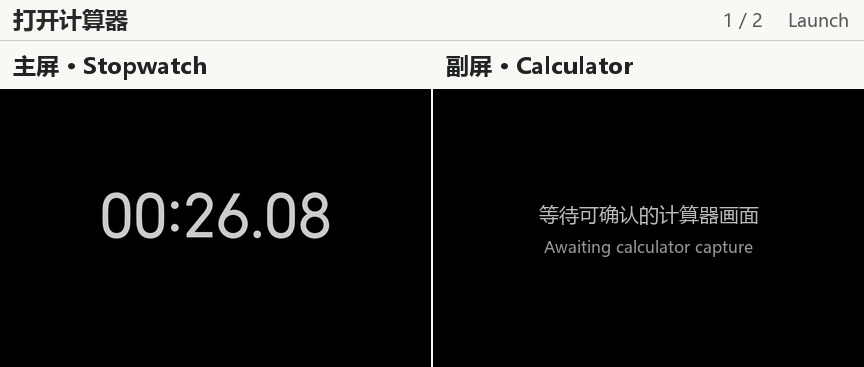
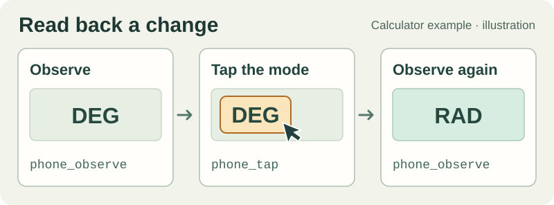
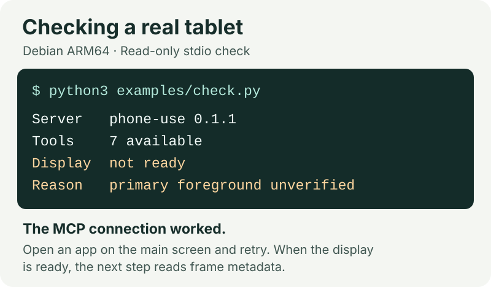

# phone-use

[English](README.en.md) · [安装](#安装) · [计算器演示](#计算器演示) · [下载发行版](https://github.com/ShuangjieGao/phone-use/releases/latest)

**给 AI 一块独立的安卓副屏，你继续使用主屏。** 我们在同一台平板上用 Moonlight 串流，同时让助手在虚拟屏上打开另一个应用。想看看助手点了什么？在电脑上打开这块副屏的只读预览即可。

项目最初为小肥鱼开发，也能接入其他支持 MCP stdio 的助手。**实测环境**为已 root 的 Android 13 平板和 ARM64 Debian chroot。

<picture>
  <source media="(prefers-reduced-motion: reduce)" srcset="docs/images/phone-use-demo-still.png">
  
</picture>

*8 秒流程示意。看右侧单位键，助手点按后会再观察一次，确认画面上出现了 `RAD`。* [单独查看 GIF](docs/images/phone-use-demo.gif) · [静态操作步骤](docs/images/observe-act.svg)

| 使用时你关心什么 | phone-use 怎样处理 |
| --- | --- |
| 我正占着平板屏幕 | `phone-display` 创建独立的 Android 显示器。启动应用、点按和滑动都指定副屏编号。不同系统可能短暂转移输入焦点。 |
| 助手怎样知道点哪里 | 默认通过中英文 OCR 获取文字和所在区域。按图标时可按需取截图；指定 `elements: false` 可以跳过 OCR。 |
| 我怎么知道它点成功了 | 点按绑定最近一次观察。界面或目标已变化时会要求重看；助手通过下一帧里的文字或图像核实操作结果。 |

## 计算器演示

配置好 MCP 后，可让助手试一句：**「在副屏打开计算器，读出当前角度单位，切换一次，告诉我实际显示什么，然后恢复原来那一档。」** 选择有 `DEG` / `RAD` 切换键的科学计算器。不同设备上的应用包名和按钮位置可能不同。



实机测试中，助手先读到 `deg`，点按后从新帧读到 `rad`，再点一次读回 `deg`。点击回执说明输入已发出；**新画面里出现的单位**才是这个任务的验收结果。

## 运行环境

- 已获取 root 的 Android 设备，配有 Debian chroot。chroot 需要看得到 Android 的 PID 1、挂载命名空间和抽象 Unix 套接字。操作端需要有权限运行 `nsenter`。这是面向已有这类环境的发行包。
- Python 3.9 或更高版本、`util-linux`、FFmpeg（支持 `-fps_mode`）和 **scrcpy-server 4.1**。
- 用 OCR 定位文字时，安装 Tesseract 及简体中文、英文语言包。Pillow 可增强对局部动画的处理，使点击前能核对按钮所在区域。

## 安装

**1. 在电脑上放置 scrcpy 服务端。** 下载官方 `scrcpy-server-v4.1`，校验 SHA-256 后放到 Android。下面的 PowerShell 命令假设电脑已经能用 `adb devices` 看到目标平板。如果连接了多台设备，给 `adb` 加 `-s <目标序列号>`。[scrcpy 4.1 官方发行页](https://github.com/Genymobile/scrcpy/releases/tag/v4.1)

```powershell
curl.exe -fL -o scrcpy-server-v4.1 https://github.com/Genymobile/scrcpy/releases/download/v4.1/scrcpy-server-v4.1
$expected = 'deacb991ed2509715160ffdc7907e47b4160eb30d1566217e9047fd5b8850cae'
if ((Get-FileHash .\scrcpy-server-v4.1 -Algorithm SHA256).Hash -ne $expected) { throw 'scrcpy-server checksum mismatch' }
adb push scrcpy-server-v4.1 /data/local/tmp/scrcpy-server-v4.1.jar
```

**2. 在平板的 Debian chroot 内安装。** 以下命令以 root 执行。Release 的 wheel 可直接安装，Python 虚拟环境会放在 `/opt/xfy-phone-venv`。[下载发行包](https://github.com/ShuangjieGao/phone-use/releases/tag/v0.1.1)

```sh
apt-get update
apt-get install -y python3-venv util-linux ffmpeg tesseract-ocr tesseract-ocr-chi-sim tesseract-ocr-eng
python3 -m venv /opt/xfy-phone-venv
/opt/xfy-phone-venv/bin/python -m pip install 'phone-use[vision] @ https://github.com/ShuangjieGao/phone-use/releases/download/v0.1.1/phone_use-0.1.1-py3-none-any.whl'
```

从源码安装时，在仓库目录运行 `/opt/xfy-phone-venv/bin/python -m pip install '.[vision]'`。

**3. 在平板上启动副屏。** 示例用 `com.android.settings` 打开系统设置。也可以将包名换为设备上已安装、且能在副屏运行的应用。先把主屏切到另一个应用，保持主屏前台可识别。

```sh
/opt/xfy-phone-venv/bin/phone-display run \
  --server-jar /data/local/tmp/scrcpy-server-v4.1.jar \
  --package com.android.settings --width 900 --height 1600 --density 360
```

保持这个进程运行。启动成功后终端输出含 `id`、`width` 和 `height` 的 JSON。`--server-jar` 填从 Android 一侧看到的路径。要释放虚拟屏，可以在另一个 Debian 终端运行 `/opt/xfy-phone-venv/bin/phone-display stop`。

### 验证副屏连接

在平板的第二个 Debian 终端里，从本仓库根目录运行下面的命令。通过 wheel 安装的用户也可以单独下载[检查脚本](examples/check.py)，把命令里的 `examples/check.py` 换成实际保存路径。

```sh
python3 examples/check.py --server /opt/xfy-phone-venv/bin/phone-use
```

脚本作为客户端启动 MCP 服务，依次核对握手、7 个工具和副屏状态；副屏就绪后再取一帧验证。它只打印检查结果，不读取 OCR 文字或返回截图。



这张图演示了一个实际遇到的情况：**MCP 连通了，副屏还不能操作**。脚本显示 `primary foreground unverified` 时，让主屏停在一个前台清晰的应用，再运行同一条命令。这样可以先定位问题，再让模型尝试操作。

## 连接 MCP 客户端

以下示例适用于在**同一平板 chroot 内**启动 stdio 子进程、支持 `mcpServers` 配置的客户端。用创建副屏的同一个系统用户启动客户端，确保它可以访问运行目录和 Unix 套接字。如果自定义了 `XFY_PHONE_RUNTIME`，请给副屏进程和 MCP 客户端配置相同的值。

```json
{
  "mcpServers": {
    "phone-use": {
      "command": "/opt/xfy-phone-venv/bin/phone-use",
      "env": { "XFY_PHONE_RUNTIME": "/run/xfy-phone-use" }
    }
  }
}
```

第一次可以问助手「查看副屏状态，告诉我屏幕尺寸」。`phone_status` 返回 `ready: true` 后就可以试[计算器演示](#计算器演示)。

### 工具一览

| MCP 工具 | 用途 |
| --- | --- |
| `phone_status` | 查看副屏是否就绪、尺寸和可识别的前台活动 |
| `phone_launch` | 根据 Android 包名在副屏启动应用 |
| `phone_observe` | 通过 OCR 返回文字区域和 `observation_id`，可选 `screenshot: true` 取图或 `elements: false` 跳过 OCR |
| `phone_tap` | 按文字区域 ID 或像素坐标点按 |
| `phone_swipe` | 在观察到的画面上滑动 |
| `phone_type` | 向输入焦点输入可打印 ASCII 文本。中文可由 OCR 读取，直接中文输入尚未实现 |
| `phone_key` | 发送 `back`、`enter` 或 `del` |

## 从电脑看同一块屏

在平板 Debian 用 `cat /run/xfy-phone-use/display.json` 查本次的 `id`。假设返回 `7`，在装有 scrcpy 4.1 的电脑上执行：

```sh
scrcpy --display-id=7 --no-control --no-audio --no-power-on
```

关闭这个只读窗口后，平板上的副屏继续运行。若状态显示 `Primary foreground could not be verified`，先回到可辨认的主屏应用，再执行 `phone_status`。若动作报告画面已变，重新 `phone_observe` 后再定位。

### 从 v0.1.0 升级

已用旧版 `xfy-phone-use` 的用户，请先下载本项目 v0.1.1 的 wheel，再在原来的虚拟环境中执行以下命令。两个发行包使用相同的 Python 模块，先卸载旧包再装新包可以避免文件互相覆盖。旧命令 `xfy-phone-use` 和 `xfy-phone-display` 仍可使用。

```sh
/opt/xfy-phone-venv/bin/python -m pip uninstall -y xfy-phone-use
/opt/xfy-phone-venv/bin/python -m pip install './phone_use-0.1.1-py3-none-any.whl[vision]'
```

## 开发与许可

```sh
python -m unittest discover -s tests -v
```

本项目按 [GNU AGPL-3.0-only](LICENSE) 开源。scrcpy、FFmpeg、Tesseract 和 Pillow 独立安装，适用各自的上游许可证。

如果你也在手机或平板上跑通了，欢迎在 [Issues](https://github.com/ShuangjieGao/phone-use/issues) 分享设备型号、Android 版本和哪个应用能在副屏上运行。这些记录可以帮助下一个人判断自己的设备是否合适。觉得这个工具有用，可以点 **Star** 收藏，或用[3D 项目介绍图](docs/images/phone-use-card.png)分享给朋友。
