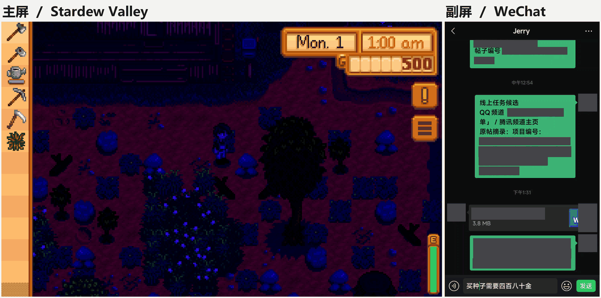

# phone-use

[English](README.en.md) · [安装指南](docs/setup.md)

**你用安卓主屏，AI 在同一台设备的副屏操作应用。** 你可以继续玩《星露谷物语》，让助手去微信发消息、用计算器算账，或者在 B 站找视频。

<picture>
  <source media="(prefers-reduced-motion: reduce)" srcset="docs/images/stardew-jerry-zh-poster.png">
  
</picture>

图中，小肥鱼在副屏核对草稿并点了「发送」，微信里出现了绿色消息气泡。两块屏幕同步录制。[看完整发送过程](docs/images/stardew-jerry-zh.mp4) · [看从空白输入框开始的中文实录](docs/images/wechat-filehelper-zh.mp4)

### 助手怎样操作手机？

- **看界面。** 平板上的 Tesseract 识别可见的中英文，把文字和位置返回给助手。遇到没有文字的图标，助手可以再请求截图。点按或滑动后看下一帧，就能检查页面有什么变化。
- **写文字。** 启用原生输入辅助后，助手把一整句中文交给当前输入框，读回核对后再决定是否发送。
- **换应用。** 在副屏打开另一个应用就能继续做事。例如在农场里走动时，副屏打开计算器算出 `24 × 20 = 480`。[计算器实录](docs/images/stardew-fullscreen.mp4)

在一次 B 站实测中，设备侧通过 MCP 找到 UP 主「Jerry的杰瑞」。小肥鱼从两条投稿中选了《人工智能视觉_第三轮预赛》，设备侧点开播放，模型从两帧里分别读出了蓝桌布旁的橙衣参赛者和场边显示器上的数字 **5**。

### 把需求告诉 AI，让它帮你安装

项目从源码安装。实测环境是**已 root 的安卓平板、ARM64 Debian chroot**，助手端支持 MCP stdio。把这句话和仓库地址发给有终端和设备访问权限的 AI 就可以开始：

> 我想继续使用安卓主屏，让你在副屏操作应用。请检查我的设备是否满足要求，按照 https://github.com/ShuangjieGao/phone-use 的安装指南从源码安装，接入我的 MCP 客户端，最后验证能否读到副屏。

[安装与排障](docs/setup.md) · [中文输入](docs/setup.md#输入中文) · [反馈设备兼容性](https://github.com/ShuangjieGao/phone-use/issues) · [AGPL-3.0-only](LICENSE)
